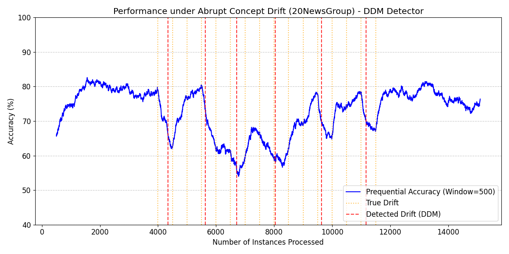
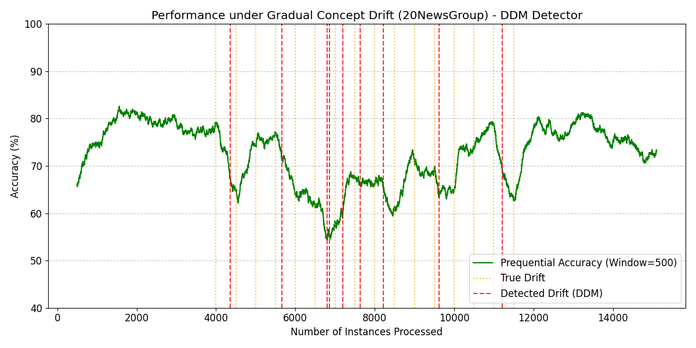
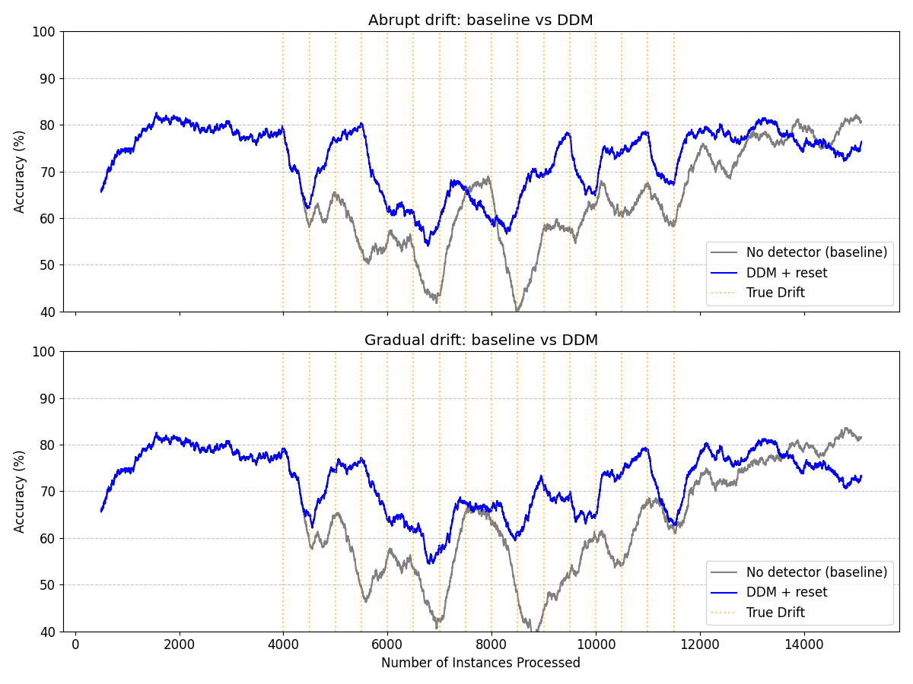

# Concept Drift Analysis in Text Data

This repository contains the source code, datasets, and experiments for my Bachelor's thesis: **"Methods for analyzing concept drift in text data" (Metódy pre analýzu concept driftu v textových dátach)**.

## Project Overview

In real-world text streams (e.g., news articles, social media posts), the underlying data distribution and the context of words often change over time due to real-world events. This phenomenon is known as **concept drift**. If machine learning models fail to adapt to these changes, their predictive accuracy degrades significantly.

The primary goal of my project is to evaluate different drift detection algorithms and adaptation strategies on text streams. I analyze two main types of concept drift:
1. **Abrupt Drift:** Sudden changes in the data distribution, representing immediate topic shifts (e.g., breaking news).
2. **Gradual Drift:** Smooth and continuous transitions where old and new concepts overlap before the new concept fully takes over.

## Methodology

### 1. Datasets
Initial experiments use vectorized text streams with simulated concept drifts from the AdaNEN framework. Both streams contain 15,102 instances with 300 features each. According to the AdaNEN repository, the class composition of the streams changes about every 500 instances between roughly 4K and 11.5K, which gives around 16 concept changes of different intensity.
- `20ng_abrupt.data`: 20NewsGroup dataset with abrupt topic shifts.
- `20ng_gradual.data`: 20NewsGroup dataset with gradual topic transitions.

### 2. Experimental Setup
I simulate an online machine learning environment where texts arrive sequentially (test-then-train).
- **Base Model:** `HoeffdingTreeClassifier` (incremental decision tree).
- **Adaptation Strategy:** Active adaptation (explicit detection). I monitor the classification error, and when a drift detector signals a change, the base model is completely reset to forget obsolete concepts.
- **Drift Detectors:** I compare standard detectors from the `River` library: ADWIN, DDM, EDDM, and Page-Hinkley.
- **Metrics:** Prequential Accuracy (over the whole stream) and Macro-F1 score (to account for potential class imbalance).

## Results

I evaluated four explicit drift detectors on both datasets. To visualize the adaptation process, I tracked the Prequential Accuracy (rolling window = 500) and plotted the points where DDM triggered a model reset.

### Experiment 1: Abrupt Drift (`20ng_abrupt.data`)


*Figure 1: Prequential accuracy under abrupt concept drift. Red dashed lines show drifts detected by DDM (model resets), orange dotted lines show the true drift positions.*

| Detector | Accuracy | Macro-F1 | Drifts Detected |
| :--- | :--- | :--- | :--- |
| **ADWIN** | 71.68% | 71.63% | 7 |
| **DDM** | 72.59% | 72.59% | 6 |
| **EDDM** | 71.03% | 71.02% | 24 |
| **Page-Hinkley** | 69.86% | 69.86% | 9 |

**Observations:**
- DDM achieved the highest accuracy and Macro-F1 with only 6 detections (at about 4350, 5650, 6700, 8050, 9600 and 11200 instances).
- Accuracy rises to about 80% in the first 2000 instances and drops after drifts, with the lowest point of about 55% near 6800 instances. After each reset it recovers to 75-80%.
- DDM found 6 of the 16 true drifts (at 4000, 5500, 6500, 8000, 9500 and 11000) with a mean delay of 172 instances.
- EDDM triggered 24 resets, much more than the other detectors.

**Conclusion (Abrupt):** DDM gave the best accuracy on the abrupt stream with the smallest number of resets. EDDM resets the model too often, and its accuracy is about 1.5% lower than DDM.

### Experiment 2: Gradual Drift (`20ng_gradual.data`)


*Figure 2: Prequential accuracy under gradual concept drift. Red dashed lines show drifts detected by DDM (model resets), orange dotted lines show the true drift positions.*

| Detector | Accuracy | Macro-F1 | Drifts Detected |
| :--- | :--- | :--- | :--- |
| **ADWIN** | 69.91% | 69.84% | 7 |
| **DDM** | 72.20% | 72.19% | 9 |
| **EDDM** | 72.18% | 72.14% | 42 |
| **Page-Hinkley** | 69.57% | 69.55% | 8 |

**Observations:**
1. **Similar structure to abrupt drift:** The first two detections (about 4350 and 5650) and the last two (about 9600 and 11200) are at almost the same positions as in the abrupt stream.
2. **Cluster of detections:** Between 6800 and 8250 instances DDM fired 5 times, two of them almost at the same moment. In total 8 of the 9 DDM detections match a true drift and only 1 is repeated, so this cluster is mostly real changes. In this part accuracy stays at about 55-68%, which is lower than in the rest of the stream.
3. **Accuracy comparison:** Accuracy dropped slightly for ADWIN, DDM and Page-Hinkley compared to the abrupt stream, which is expected because the tree has to deal with mixed old and new concepts. EDDM is the exception and improved from 71.03% to 72.18%.
4. **EDDM sensitivity:** EDDM triggered 42 resets and found 15 of the 16 true drifts, but 27 of the resets are extra (23 repeated and 4 outside the windows).

**Conclusion (Gradual):** DDM and EDDM reach practically the same accuracy (72.20% vs 72.18%), but DDM needs only 9 resets and EDDM needs 42. The difference between them is very small, so it shows a trend and not a strict ranking. ADWIN and Page-Hinkley are about 2.3-2.6% worse.

## Baseline and Detection Quality

To check if the adaptation helps, I also ran the same Hoeffding Tree without any drift detector. The true drift positions (about every 500 instances between 4K and 11.5K, 16 in total) are known from the AdaNEN description, so I could also measure how well the detectors find them. A true drift counts as found if the detector fires in the 500 instances after it.


*Figure 3: Prequential accuracy of the tree without a detector (gray) and with DDM resets (blue). Orange dotted lines show the true drifts.*

| Stream | Method | Accuracy | Macro-F1 | Resets |
| :--- | :--- | :--- | :--- | :--- |
| Abrupt | No detector | 67.24% | 67.24% | 0 |
| Abrupt | DDM | 72.59% | 72.59% | 6 |
| Gradual | No detector | 66.64% | 66.64% | 0 |
| Gradual | DDM | 72.20% | 72.19% | 9 |

| Stream | Detector | Resets | Found | Mean delay | Repeated | Outside |
| :--- | :--- | :--- | :--- | :--- | :--- | :--- |
| Abrupt | DDM | 6 | 6/16 | 172 | 0 | 0 |
| Abrupt | ADWIN | 7 | 6/16 | 164 | 0 | 1 |
| Abrupt | EDDM | 24 | 9/16 | 172 | 12 | 3 |
| Abrupt | Page-Hinkley | 9 | 5/16 | 295 | 0 | 4 |
| Gradual | DDM | 9 | 8/16 | 212 | 1 | 0 |
| Gradual | ADWIN | 7 | 6/16 | 224 | 0 | 1 |
| Gradual | EDDM | 42 | 15/16 | 102 | 23 | 4 |
| Gradual | Page-Hinkley | 8 | 5/16 | 255 | 0 | 3 |

**Observations:**
- The tree without a detector falls to about 40% in the middle of the stream, while the lowest point of DDM is about 55%.
- Near the end of the stream (after about 14000 instances) the baseline is better than DDM (about 80-82% against 73-76%), probably because the reset removes what the tree learned before.
- DDM and ADWIN make almost no extra detections, but find only 6-8 of the 16 true drifts. EDDM finds the most (9/16 and 15/16), but most of its resets are extra.
- Page-Hinkley is the slowest (mean delay 295 and 255) and finds the fewest drifts (5/16).
- The windows cover the whole range from 4000 to 12000, so the "Found" value of EDDM can be partly caused by its very frequent detections.

**Conclusion (Baseline and Detection Quality):** Active adaptation helps: DDM is about 5 points better than the tree without a detector on both streams (+5.35 on abrupt, +5.56 on gradual). DDM finds only about half of the true drifts, but it has almost no extra detections. EDDM finds the most drifts, but this does not give it better accuracy than DDM.

## Project Structure
```
├── data/
│   ├── adanen_streams/        # 20ng_abrupt.data, 20ng_gradual.data
│   └── real_data/             # real text data (not used in the experiments yet)
├── images/                    # figures used in this README
├── notebooks/
│   ├── 01_explore_adanen_data.ipynb
│   ├── 02_visualize_drift_results.ipynb
│   └── 03_baseline_and_detection_quality.ipynb
├── src/
│   ├── data_loader.py         # loading and streaming of AdaNEN data
│   ├── detectors_abrupt.py    # detector comparison on the abrupt stream
│   └── detectors_gradual.py   # detector comparison on the gradual stream
├── requirements.txt
└── README.md
```

## Getting Started

1. Clone this repository:
   ```bash
   git clone https://github.com/Yan-Pasichnyi/Concept-Drift-Analysis-in-Text-Data.git
   cd Concept-Drift-Analysis-in-Text-Data
   ```
2. Install the dependencies:
   ```bash
   pip install -r requirements.txt
   ```
3. Run the detector comparison scripts to reproduce the tables:
   ```bash
   python src/detectors_abrupt.py
   python src/detectors_gradual.py
   ```
4. Open the notebooks in the `notebooks/` folder to explore the data, see the plots, and run the baseline and detection quality experiments.