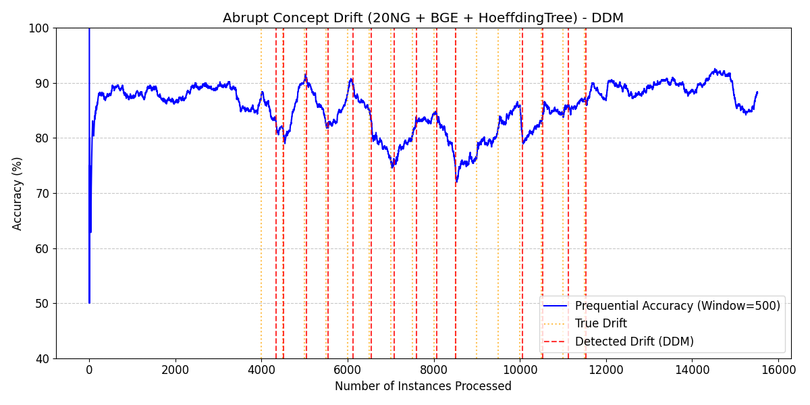
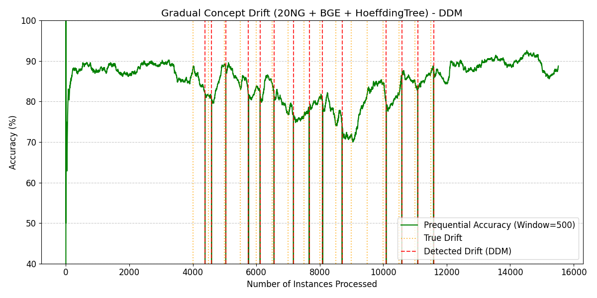
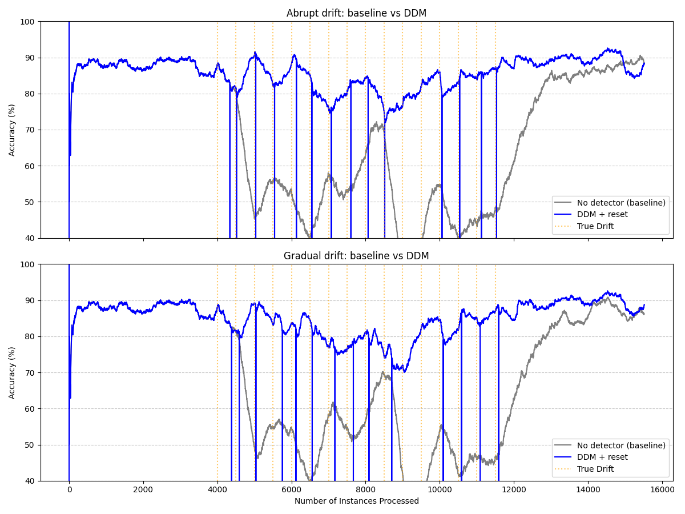

# Concept Drift Analysis in Text Data

This repository contains the source code and experiments for my Bachelor's project: **"Methods for analyzing concept drift in text data" (Metódy pre analýzu concept driftu v textových dátach)**.

## Abstract

Text streams such as news articles or social media posts change over time, and a classifier that does not adapt to these changes loses accuracy. This problem is called concept drift. This project studies how concept drift can be detected and handled in text streams. I construct abrupt and gradual drift streams directly from the raw 20 Newsgroups dataset (15,518 documents across 4 super-topics, encoded into 384-dimensional embeddings with a frozen `BAAI/bge-small-en-v1.5` model, with 16 known concept changes) and use an incremental Hoeffding Tree that is reset when a drift detector (ADWIN, DDM, EDDM, or Page-Hinkley) signals a change.

The experiments compare the detectors by accuracy and Macro-F1, compare active adaptation with a baseline without any detector, and measure how well the detectors find the true drifts (found drifts, delay, repeated and outside detections). The results are given for a main run with seed 42 and as mean ± standard deviation over 5 random seeds. Active adaptation with DDM improves accuracy by about 15 percentage points over the baseline (mean over 5 seeds). DDM finds 13–14 of the 16 true drifts and did not fire outside the detection windows in any of the 5 seeds, while EDDM reaches a similar accuracy with the lowest delay at the cost of extra resets. The contribution of this work is a reproducible comparison of drift detectors on text streams with known drift positions, without corpus-level data leakage, which serves as a base for further experiments with real text data. The work is in progress.

## Project Overview

In real-world text streams (e.g., news articles, social media posts), the underlying data distribution and the context of words often change over time due to real-world events. This phenomenon is known as **concept drift**. If machine learning models fail to adapt to these changes, their predictive accuracy degrades significantly. A general overview of concept drift and domain shift is given in [1], and an overview of concept drift adaptation in text streams in [2].

The primary goal of my project is to evaluate different drift detection algorithms and adaptation strategies on text streams. I analyze two main types of concept drift:
1. **Abrupt Drift:** Sudden changes in the data distribution, representing immediate topic shifts (e.g., breaking news).
2. **Gradual Drift:** Smooth and continuous transitions where old and new concepts overlap before the new concept fully takes over.

## Methodology

### 1. Dataset and Stream Construction
Both streams are constructed directly from the raw **20 Newsgroups** dataset (`headers`, `footers`, and `quotes` removed) across 4 super-topics (`comp`, `rec`, `sci`, `talk`), totaling 15,518 documents. The categories `alt.atheism`, `misc.forsale` and `soc.religion.christian` are not used, because they do not belong to any of the 4 super-topics, and documents shorter than 20 characters are removed.
- **Feature Extraction:** Each document is encoded independently into a 384-dimensional vector using the frozen pretrained transformer `BAAI/bge-small-en-v1.5`. Because each text is embedded in isolation without fitting a vectorizer on future texts, and the model is not trained or tuned on the stream, this setup avoids corpus-level data leakage. The embeddings are computed once in a fixed order and cached; the order of the stream is shuffled afterwards using the seed.
- **Drift Simulation:** Following the topic-switching schedule and transition windows (`1/DI`) defined in the AdaNEN framework [3], the target labels change every 500 instances between indices `4000` and `11500` (16 concept changes in total), either instantaneously (`abrupt`) or over gradual transition windows (`gradual`, window widths from 25 to 250 instances). Each of the 4 super-topics is mapped to a binary label, and this mapping changes at every drift. Only the relation between the text and its label changes, while the texts themselves stay the same, so the drift is synthetic.

### 2. Experimental Setup
I simulate an online machine learning environment where texts arrive sequentially (test-then-train).
- **Base Model:** `HoeffdingTreeClassifier` (incremental decision tree) from the `River` library [4].
- **Adaptation Strategy:** Active adaptation (explicit detection). I monitor the classification error, and when a drift detector signals a change, the base model is completely reset to forget obsolete concepts.
- **Drift Detectors:** I compare standard detectors from the `River` library: ADWIN, DDM, EDDM, and Page-Hinkley. The detectors and the tree use the default `River` parameters.
- **Metrics:** Prequential Accuracy (over the whole stream) and Macro-F1 score (in all runs it is almost identical to accuracy), along with detection quality metrics (Found, Mean Delay, Repeated, and Outside detections).
- **Seeds:** The main results (tables and figures) come from seed 42. The seed changes the order of the documents in the stream and the random mixing of the old and new rules in the gradual transition windows. The stability of the results is checked with 5 seeds (42, 1, 2, 3, 4).

## Results

I evaluated four explicit drift detectors on both streams (seed 42). To visualize the adaptation process, I tracked the Prequential Accuracy (rolling window = 500) and plotted the points where DDM triggered a model reset.

### Experiment 1: Abrupt Drift


*Figure 1: Prequential accuracy under abrupt concept drift (seed 42). Red dashed lines show drifts detected by DDM (model resets), orange dotted lines show the true drift positions.*

| Detector | Accuracy | Macro-F1 | Resets |
| :--- | :---: | :---: | :---: |
| **ADWIN** | 82.94% | 82.93% | 9 |
| **DDM** | 85.67% | 85.66% | 14 |
| **EDDM** | 86.61% | 86.60% | 24 |
| **Page-Hinkley** | 82.71% | 82.69% | 9 |

**Observations:**
- Rolling accuracy rises quickly in the first 500 instances and stays around 85–90% before the first true drift at index 4000.
- DDM triggered 14 resets, reacting to 14 of the 16 true drifts (missing only the changes at 9000 and 9500). After each drift, accuracy dips (reaching its lowest point of about 72% near index 8500) and recovers back to 82–91% after the tree is reset.
- After the final drift at 11500, the model stabilizes around 85–92% and finishes near 88%.
- EDDM achieved the highest overall accuracy (86.61%), while triggering 24 resets.

**Conclusion (Abrupt):** Both EDDM (86.61%) and DDM (85.67%) performed strongly on the abrupt stream, outperforming ADWIN and Page-Hinkley by roughly 2.7–3.9 percentage points. DDM reached nearly the same accuracy as EDDM while requiring 10 fewer model resets.

### Experiment 2: Gradual Drift


*Figure 2: Prequential accuracy under gradual concept drift (seed 42). Red dashed lines show drifts detected by DDM (model resets), orange dotted lines show the true drift positions.*

| Detector | Accuracy | Macro-F1 | Resets |
| :--- | :---: | :---: | :---: |
| **ADWIN** | 82.74% | 82.73% | 9 |
| **DDM** | 85.06% | 85.04% | 14 |
| **EDDM** | 85.20% | 85.19% | 21 |
| **Page-Hinkley** | 82.42% | 82.41% | 9 |

**Observations:**
1. **Similar detection count to abrupt drift:** DDM again triggered 14 resets, detecting 14 of the 16 true drifts and missing only the changes around 9000 and 9500.
2. **Lowest accuracy during missed drifts:** Around index 9000, where two consecutive drifts were missed, rolling accuracy dropped to about 70%. After the last drift at 11500, it recovered above 85–90%.
3. **Accuracy comparison:** Overall accuracy decreased slightly across all detectors compared to the abrupt stream (e.g., DDM from 85.67% to 85.06%, EDDM from 86.61% to 85.20%), which is expected because old and new concepts overlap during transition windows.
4. **EDDM sensitivity:** EDDM triggered 21 resets compared to 14 for DDM, while reaching almost the same accuracy (85.20% vs 85.06%).

**Conclusion (Gradual):** DDM and EDDM achieved practically the same accuracy on the gradual stream (85.06% vs 85.20%), with DDM needing fewer resets (14 vs 21). ADWIN and Page-Hinkley were about 2.3–2.8 percentage points lower.

## Baseline and Detection Quality

To check if active adaptation helps, I also ran the same Hoeffding Tree without any drift detector. Since the 16 true drift positions (every 500 instances between 4000 and 11500) are known, I measured how accurately each detector finds them. Every detection is matched to the nearest preceding true drift `t`. A true drift counts as found if a detector fires in `[t, t + 400)`, and the delay is the distance between `t` and the first such detection. Further detections for an already found drift are counted as repeated, and detections before the first drift or 400 or more instances after the nearest preceding drift are counted as outside. The window is shorter than the 500 instances between the true drifts, but the matching is still approximate: a very late detection of drift `t` that arrives after `t + 500` cannot be told apart from an early detection of the next drift. The mean delay is computed only over the found drifts.


*Figure 3: Prequential accuracy of the tree without a detector (gray) and with DDM resets (blue), seed 42. Orange dotted lines show the true drifts. The vertical axis is cut at 40%.*

| Stream | Method | Accuracy | Macro-F1 | Resets |
| :--- | :--- | :---: | :---: | :---: |
| Abrupt | No detector | 68.81% | 68.80% | 0 |
| Abrupt | DDM | 85.67% | 85.66% | 14 |
| Gradual | No detector | 68.93% | 68.91% | 0 |
| Gradual | DDM | 85.06% | 85.04% | 14 |

| Stream | Detector | Resets | Found | Mean delay | Repeated | Outside |
| :--- | :--- | :---: | :---: | :---: | :---: | :---: |
| Abrupt | DDM | 14 | 14/16 | 80.4 | 0 | 0 |
| Abrupt | ADWIN | 9 | 5/16 | 101.0 | 0 | 4 |
| Abrupt | EDDM | 24 | 16/16 | 51.1 | 3 | 5 |
| Abrupt | Page-Hinkley | 9 | 7/16 | 172.9 | 0 | 2 |
| Gradual | DDM | 14 | 14/16 | 138.2 | 0 | 0 |
| Gradual | ADWIN | 9 | 7/16 | 90.7 | 0 | 2 |
| Gradual | EDDM | 21 | 13/16 | 74.5 | 3 | 5 |
| Gradual | Page-Hinkley | 9 | 8/16 | 143.6 | 0 | 1 |

**Observations:**
- Without a detector, rolling accuracy drops below 40% in several places during the drift period (roughly near indices 6500, 9000–9500 and 10500), whereas DDM keeps rolling accuracy at about 70% or higher.
- After the final drift at 11500, the baseline model gradually recovers on the stationary tail of the stream, reaching 85–90% near the end and approaching the DDM curve.
- DDM finds 14/16 true drifts on both streams with 0 repeated detections and 0 outside detections in this run, making it the cleanest detector.
- EDDM has the shortest mean delay (51.1 on abrupt, 74.5 on gradual) and finds all 16/16 drifts on the abrupt stream (13/16 on the gradual stream), but triggers extra resets (3 repeated and 5 outside on both streams).
- ADWIN and Page-Hinkley find only 5–8 of the 16 true drifts and also have a few outside detections (1–4), because some of their detections come too late to be matched to a drift.
- Comparing abrupt and gradual drift, the main difference appears in detection delay: for both DDM (80.4 vs 138.2) and EDDM (51.1 vs 74.5), the delay grows on gradual drift because the concept shifts gradually.

**Conclusion (Baseline and Detection Quality):** Active adaptation brings a substantial gain: in the seed 42 run, DDM improves accuracy by +16.86 percentage points on abrupt drift and +16.13 percentage points on gradual drift over the tree without a detector (the mean gain over 5 seeds is about 15 percentage points, see below). DDM is the most balanced detector overall (14/16 true drifts found with no extra detections), while EDDM reaches slightly higher accuracy and lower delay at the cost of extra resets.

## Stability Across Random Seeds

All results above come from one run with seed 42. To see how much they depend on the seed, I repeated all experiments with 5 seeds (42, 1, 2, 3, 4) and report the mean ± standard deviation. The embeddings are computed only once, so only the order of the stream (and the mixing in the gradual windows) changes. The results of every seed are saved to `multi_seed_results.csv` by notebook 03 (this file is not tracked by git).

| Stream | Method | Accuracy | Macro-F1 | Resets | Found (of 16) | Mean delay | Repeated | Outside |
| :--- | :--- | :---: | :---: | :---: | :---: | :---: | :---: | :---: |
| Abrupt | No detector | 70.10 ± 0.88 | 70.08 ± 0.88 | 0 | - | - | - | - |
| Abrupt | ADWIN | 83.39 ± 0.92 | 83.37 ± 0.92 | 9.40 ± 1.14 | 7.80 ± 1.92 | 92.35 ± 11.45 | 0.00 ± 0.00 | 1.60 ± 1.67 |
| Abrupt | DDM | 85.51 ± 0.44 | 85.49 ± 0.45 | 14.20 ± 0.84 | 13.60 ± 0.55 | 77.10 ± 21.62 | 0.60 ± 0.89 | 0.00 ± 0.00 |
| Abrupt | EDDM | 86.04 ± 0.59 | 86.02 ± 0.60 | 24.00 ± 3.81 | 14.80 ± 1.30 | 51.39 ± 11.31 | 4.60 ± 2.07 | 4.60 ± 3.51 |
| Abrupt | Page-Hinkley | 82.49 ± 0.35 | 82.46 ± 0.37 | 8.80 ± 1.10 | 7.40 ± 0.89 | 143.75 ± 30.60 | 0.00 ± 0.00 | 1.40 ± 0.89 |
| Gradual | No detector | 70.05 ± 0.74 | 70.02 ± 0.74 | 0 | - | - | - | - |
| Gradual | ADWIN | 83.26 ± 0.67 | 83.25 ± 0.67 | 10.00 ± 1.22 | 8.20 ± 0.84 | 129.81 ± 30.71 | 0.00 ± 0.00 | 1.80 ± 1.48 |
| Gradual | DDM | 85.00 ± 0.40 | 84.98 ± 0.40 | 13.60 ± 1.52 | 13.20 ± 0.84 | 125.49 ± 18.16 | 0.40 ± 0.89 | 0.00 ± 0.00 |
| Gradual | EDDM | 85.38 ± 0.34 | 85.37 ± 0.34 | 24.00 ± 5.48 | 14.20 ± 1.30 | 76.38 ± 8.05 | 6.20 ± 3.11 | 3.60 ± 4.04 |
| Gradual | Page-Hinkley | 82.41 ± 0.50 | 82.39 ± 0.50 | 9.40 ± 0.55 | 7.60 ± 1.14 | 172.64 ± 20.36 | 0.00 ± 0.00 | 1.80 ± 0.84 |

**Observations:**
- DDM and EDDM reach the highest accuracy on both streams. EDDM is slightly more accurate: the difference is 0.53 percentage points on the abrupt stream (EDDM is better in all 5 seeds, by 0.32–0.94) and 0.38 percentage points on the gradual stream (EDDM is better in 4 of 5 seeds, by −0.03 to 0.92). The difference is small, EDDM needs about 10 more resets than DDM, and with only 5 seeds it should not be over-interpreted.
- The mean gain of DDM over the tree without a detector is +15.4 percentage points on the abrupt stream and +15.0 percentage points on the gradual stream. The seed 42 run shows a larger gain because the baseline accuracy in that run (68.8–68.9%) is lower than the mean over seeds (about 70.1%).
- DDM did not fire outside the windows in any seed (0 outside) and produced few repeated detections (0.4–0.6 on average). It finds 13.2–13.6 of the 16 drifts.
- EDDM has the shortest mean delay (51.4 abrupt, 76.4 gradual) and finds the most drifts (14.2–14.8 of 16), but it makes about 24 resets with 4.6–6.2 repeated and 3.6–4.6 outside detections, and these numbers vary a lot between seeds.
- ADWIN and Page-Hinkley find only 7–8 of the 16 drifts on average and have a longer delay.
- The standard deviation of the mean delay is large (up to about 30), so small differences in delay between detectors should not be over-interpreted.

**Conclusion (Seeds):** The main findings hold across seeds: active adaptation improves accuracy by about 15 percentage points, DDM and EDDM are about 1.7–3.6 percentage points more accurate than ADWIN and Page-Hinkley, EDDM is slightly (about 0.4–0.5 percentage points) more accurate than DDM, DDM is the cleaner detector, and EDDM is the faster but noisier one. The exact numbers of a single run (for example the +16.86 percentage point gain on the abrupt stream or "14/16 with no repeated detections" for seed 42) depend on the seed.

## Project Structure

Instructions for installation and running the project are in [`doc/user_guide.md`](doc/user_guide.md).

```text
├── data/
│   └── real_data/             # real text data (not used in the experiments yet)
├── doc/
│   └── user_guide.md          # installation, running the scripts and notebooks
├── images/                    # figures used in this README
├── notebooks/
│   ├── 01_explore_20ng_data.ipynb
│   ├── 02_visualize_drift_results.ipynb
│   └── 03_baseline_and_detection_quality.ipynb   # also the multi-seed experiment
├── src/
│   ├── data_loader.py         # raw 20NG loading, BGE embeddings, drift streams
│   ├── evaluation.py          # prequential evaluation, detectors, baselines, detection quality
│   ├── plotting.py            # plots used in the notebooks
│   ├── detectors_abrupt.py    # detector comparison on the abrupt stream
│   └── detectors_gradual.py   # detector comparison on the gradual stream
├── requirements.txt
└── README.md
```

## References

[1] J.-L. Li, C.-F. Hsu, M.-C. Chang, W.-C. Chen. *A Comprehensive Review of Machine Learning Advances on Data Change: A Cross-Field Perspective.* arXiv:2402.12627, 2024. https://arxiv.org/abs/2402.12627

[2] C. M. Garcia, R. Abilio, A. L. Koerich, A. de Souza Britto, J. P. Barddal. *Concept Drift Adaptation in Text Stream Mining Settings: A Systematic Review.* ACM Transactions on Intelligent Systems and Technology, 16(2), 2025. https://doi.org/10.1145/3704922

[3] P. Ghahramanian, S. Bakhshi, H. Bonab, F. Can. *A Novel Neural Ensemble Architecture for On-the-fly Classification of Evolving Text Streams.* ACM Transactions on Knowledge Discovery from Data, 18(4), Article 101, 2024. https://doi.org/10.1145/3639054. Data streams and code: https://github.com/PouyaGhahramanian/AdaNEN

[4] J. Montiel et al. *River: machine learning for streaming data in Python.* Journal of Machine Learning Research, 22, 2021. Documentation: https://riverml.xyz